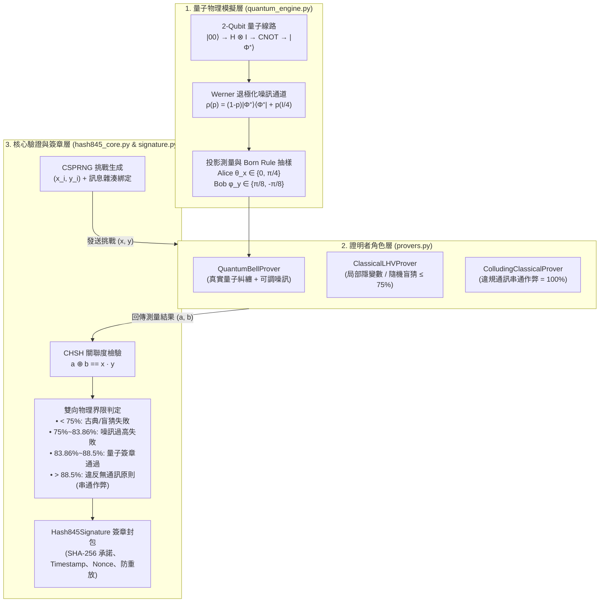

# Hash845 專案擴充實作計畫 (DI-QZKP 量子簽章與驗證系統)

## 目標說明 (Goal Description)

將目前的單檔概念雛形 [hash845_core.py](../hash845_core.py) 擴充為完整、零外部依賴（純 Python 標準庫）的 **設備無關量子零知識證明與數位簽章套件（DI-QZKP Signature Suite）**。擴充內容涵蓋三大核心模組：
1. **純 Python 量子線路與密度矩陣模擬引擎**：不依賴外部框架，直接以標準庫 `complex` 與 `math` 實作雙量子位元（2-Qubit）態向量、量子邏輯閘（$H, \text{CNOT}, R_y(\theta)$）、Werner 退極化噪訊通道（Depolarizing Channel）與玻恩定則（Born Rule）投影測量。
2. **完整 CHSH 協議與多型態證明者（Provers）**：修復現有字串格式化 Bug，落實 $a \oplus b = x \cdot y$ 逐輪驗證，並新增**雙向界限檢測**（同時攔截低於古典極限 $75\%$ 的盲猜攻擊，以及高於量子 Tsirelson 上限 $85.36\%$ 的「古典違反類空分離串通作弊」）。
3. **密碼學訊息綁定與防重放簽章封包**：利用 `hashlib` (SHA-256) 將待簽章訊息（如交易內容）、時間戳記、Nonce 與 1000 輪量子挑戰-回應軌跡進行密碼學承諾綁定，產生可序列化與離線稽核的 `Hash845Signature` 簽章憑證。

---

## 架構設計圖 (Architecture Diagram)



---

## 關鍵設計決策 (Key Design Decisions)

> [!IMPORTANT]
> **新增「超量子上限（Super-Quantum / Signaling Attack）」防禦機制**
> 在真實 CHSH 驗證中，若攻擊者的兩個節點偷偷透過古典網路串通（違反類空分離 No-signaling 假設），他們能湊出 $100\%$ 的勝率。然而物理上的量子力學最高只能達到 Tsirelson's Bound（$\frac{2+\sqrt{2}}{4} \approx 85.36\%$）。
> 因此我們在驗證器中加入了**上界檢查（預設容許約 $3\sigma$ 統計波動，上限約 $88.8\%$）**：若勝率異常趨近 $100\%$，系統會精準識破並回報「違反非定域性無通訊原則（古典串通作弊）」。

---

## 擬議變更明細 (Proposed Changes)

### 1. 純 Python 量子態與密度矩陣引擎

#### [NEW] `quantum_engine.py`
* 使用標準庫 `math`、`cmath`、`secrets` 實作無外部依賴的 $4 \times 4$ 複數矩陣與雙量子位元密度矩陣類別 `BellStateSimulator`：
  * **量子線路製備**：從基底態 $|00\rangle$ 出發，套用阿達馬閘（$H \otimes I$）與受控非門（$\text{CNOT}$）產生最大糾纏貝爾態 $|\Phi^+\rangle = \frac{|00\rangle + |11\rangle}{\sqrt{2}}$。
  * **物理噪訊模型**：支援設定退極化噪訊參數 `noise_prob` $p \in [0, 1]$，建構混合態密度矩陣 $\rho = (1 - p)|\Phi^+\rangle\langle\Phi^+| + p \frac{I_4}{4}$。
  * **任意角度投影測量**：根據 Alice 的測量角 $\theta_x$ 與 Bob 的測量角 $\phi_y$，計算聯合機率分佈：
    $$P(a, b \mid \theta_x, \phi_y) = \text{Tr}\left(\rho \cdot (\Pi_a(\theta_x) \otimes \Pi_b(\phi_y))\right)$$
    並使用密碼學安全隨機數進行物理抽樣回傳 $(a, b) \in \{0, 1\}^2$。

---

### 2. 證明者角色模組（量子 vs. 古典 vs. 串通攻擊）

#### [NEW] `provers.py`
* 定義統一介面 `BaseProver.respond(x: int, y: int) -> tuple[int, int]`：
  * `QuantumBellProver(noise_prob=0.0)`：呼叫 `BellStateSimulator`，採用 CHSH 最佳測量角度（$x=0 \to 0, x=1 \to \frac{\pi}{4}$；$y=0 \to \frac{\pi}{8}, y=1 \to -\frac{\pi}{8}$），在無噪訊時理論勝率為 $85.36\%$。
  * `ClassicalLHVProver(strategy="optimal" | "random")`：
    * `"optimal"`：採用最佳局部隱變數策略（固定輸出 $(0, 0)$ 或共享預先約定的古典隨機表），平均勝率嚴格受限於 $75\%$。
    * `"random"`：純隨機盲猜，平均勝率 $50\%$。
  * `ColludingClassicalProver()`：模擬未隔離的古典作弊設備（同時讀取 $x, y$ 並令 $a = x \cdot y, b = 0$），勝率達 $100\%$，用於展示驗證器對超量子界限作弊的攔截能力。

---

### 3. 核心驗證器升級與 Bug 修復

#### [MODIFY] `hash845_core.py`
* **修復 Bug**：修正第 36、38、40 行 `{actual_ratio:.2%2f}` 造成的 `ValueError`，改為合法的 `{actual_ratio:.2%}`。
* **完整 CHSH 驗證方法**：
  * 新增 `evaluate_round(x, y, a, b) -> bool`：嚴格檢查位元域與 $(a \oplus b) == (x \cdot y)$。
  * 新增 `run_interactive_challenge(prover) -> dict`：自動執行 `rounds` 輪挑戰，收集完整軌跡並呼叫 `verify_proof()`。
  * 升級 `verify_proof(prover_results)`：新增 `STATISTICAL_UPPER_LIMIT`（預設 `QUANTUM_LIMIT + 0.035`，約 $88.86\%$，對應 $N=1000$ 時超過 $3\sigma$ 的極端上界），區分四種判定狀態：
    1. **驗證成功（Quantum Verified）**：介於 `[QUANTUM_LIMIT - 0.015, QUANTUM_LIMIT + 0.035]`。
    2. **古典串通作弊警報（Signaling / Collusion Detected）**：高於 `QUANTUM_LIMIT + 0.035`（違反無通訊原則）。
    3. **嚴重噪訊干擾（High Noise / Decoherence）**：介於 `(CLASSICAL_LIMIT, QUANTUM_LIMIT - 0.015)`。
    4. **古典演算法或盲猜失敗（Classical / Random Rejected）**：低於或等於 `CLASSICAL_LIMIT (0.75)`。

---

### 4. 密碼學訊息綁定與防重放簽章系統

#### [NEW] `signature.py`
* 實作 `Hash845Signer` 與 `Hash845SignatureVerifier`：
  * **簽章結構 (`Hash845Signature`)**：包含 `message`、`message_hash` (SHA-256)、`timestamp`、`nonce`、`rounds`、`transcript_root`（將每一輪的 $(i, x_i, y_i, a_i, b_i)$ 與訊息雜湊串接後的雜湊鏈承諾 / Merkle-like 軌跡摘要）、`actual_ratio` 與 `signature_digest`。
  * **防重放與防竄改機制**：
    * 每一輪挑戰除了包含驗證節點的隨機熵，還會混入 `SHA256(message || nonce || timestamp || round_index)` 的承諾綁定。
    * 支援檢查已使用過的 `nonce` 集合（防止 Replay Attack 重放舊的量子測量結果）以及訊息內容是否遭竄改。
    * 支援 JSON 匯出與載入（`to_json()` / `from_json()`）。

---

### 5. 自動化測試與文件更新

#### [NEW] `test_hash845.py`
* 使用標準庫 `unittest` 編寫完整測試案例：
  * 測試貝爾態密度矩陣的跡（$\text{Tr}(\rho) = 1$）與理論 CHSH 機率分佈精確吻合 $\cos^2(\pi/8)$。
  * 測試無噪訊量子證明者、高噪訊量子證明者、古典最佳證明者、古典盲猜者與古典串通作弊者的驗證結果。
  * 測試訊息簽章生成、篡改訊息攔截、篡改軌跡攔截與重放攻擊（Replay Attack）攔截。

#### [MODIFY] `README.md`
* 擴充專案說明文件，包含物理數學原理、系統架構、快速啟動指令與各模組 API 說明。

---

## 驗證計畫 (Verification Plan)

### 自動化測試 (Automated Tests)
執行內建單元測試套件與主程式展示腳本：
```powershell
python -m unittest discover -s . -p "test_*.py" -v
python hash845_core.py
```
預期所有測試案例皆為 `OK`，且主程式能清楚印出不同證明者（完美量子、微噪訊量子、高噪訊量子、古典 LHV、古典串通作弊）的對比測試與訊息簽章驗證結果。
